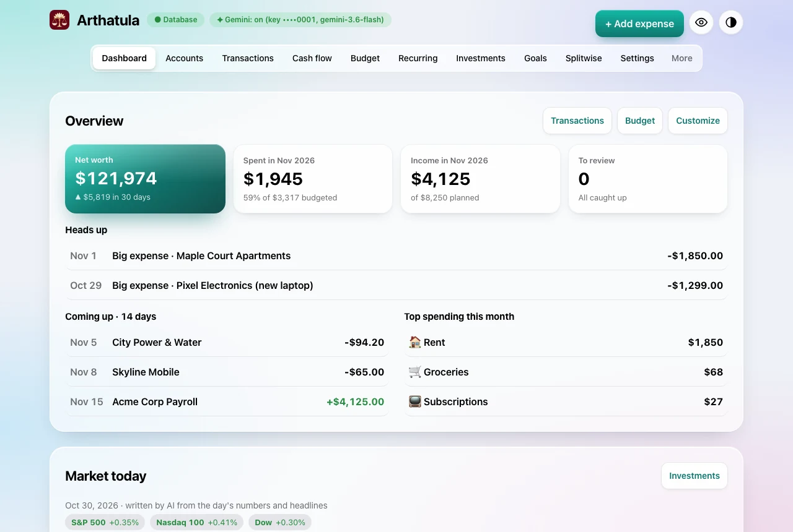
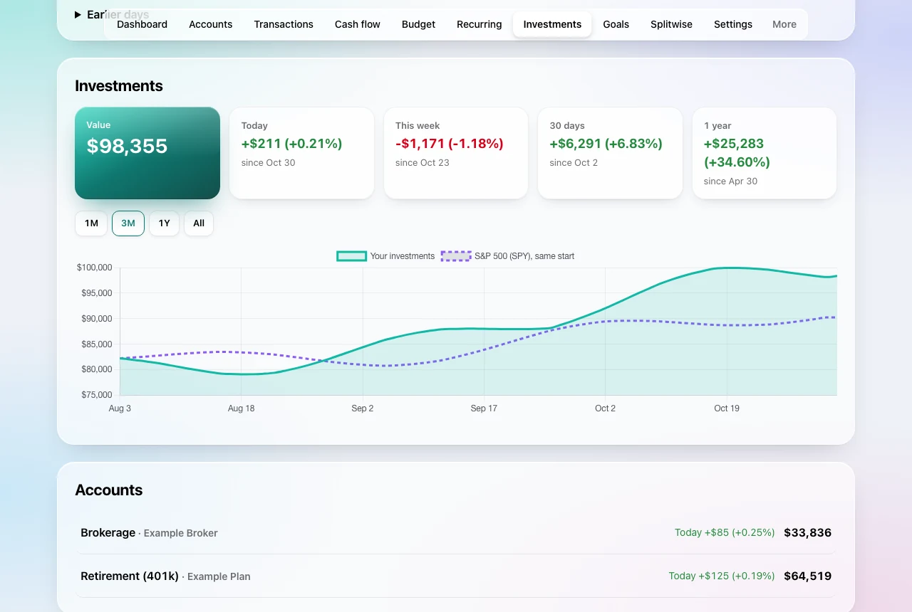
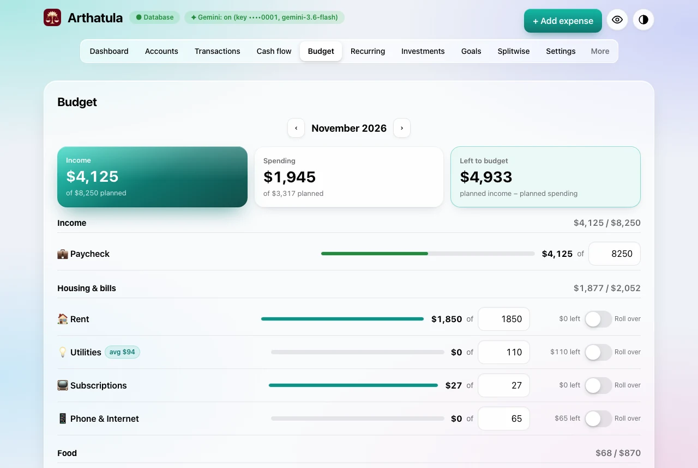
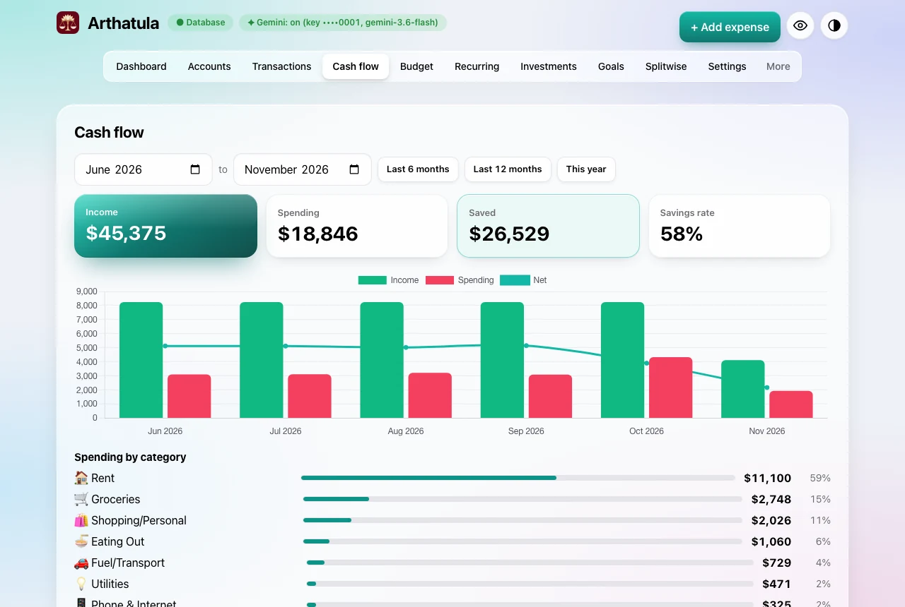
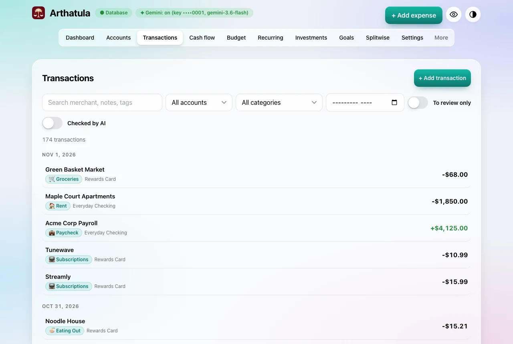
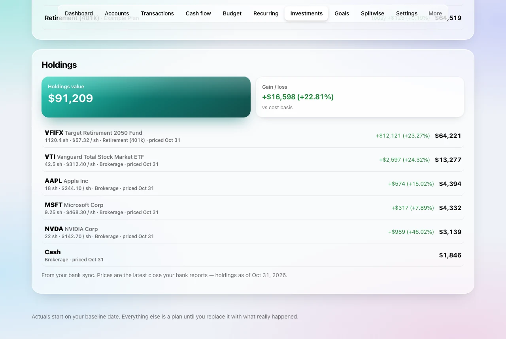
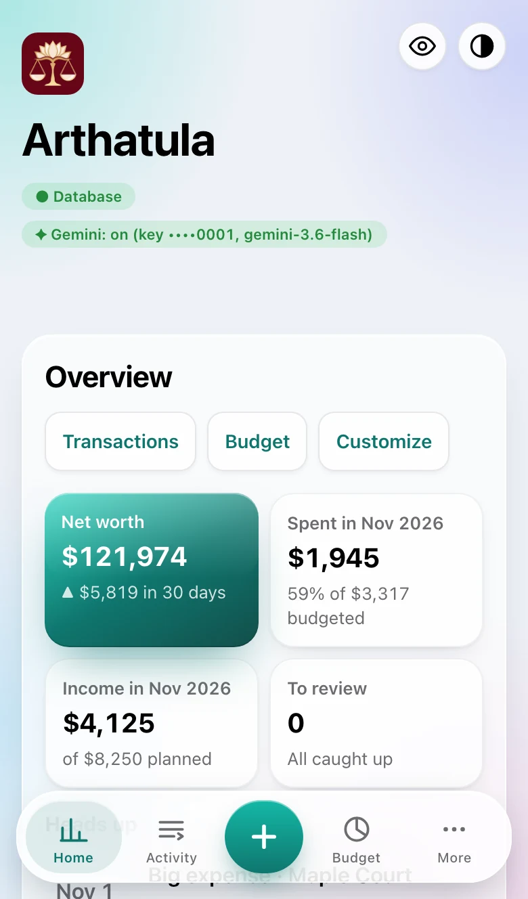
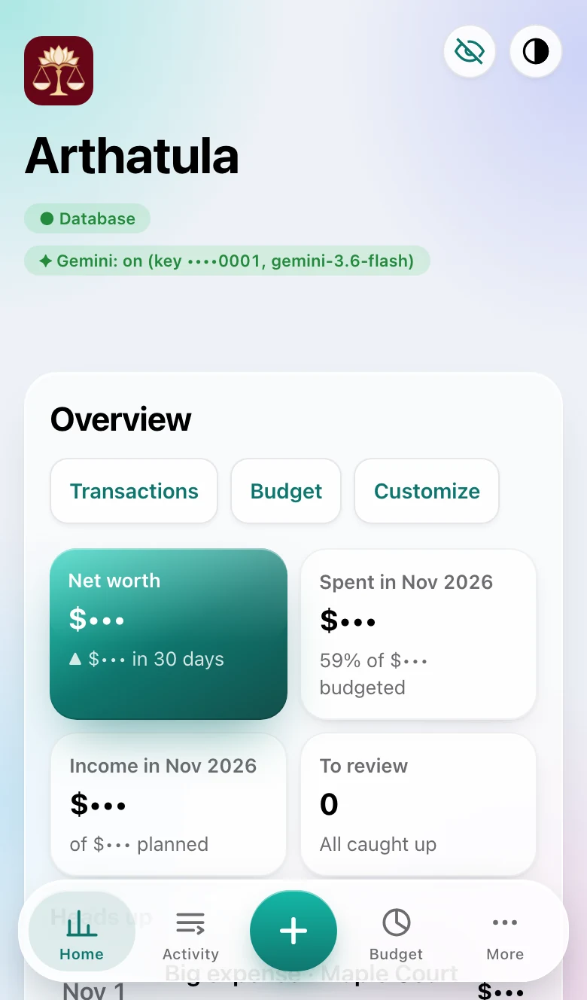
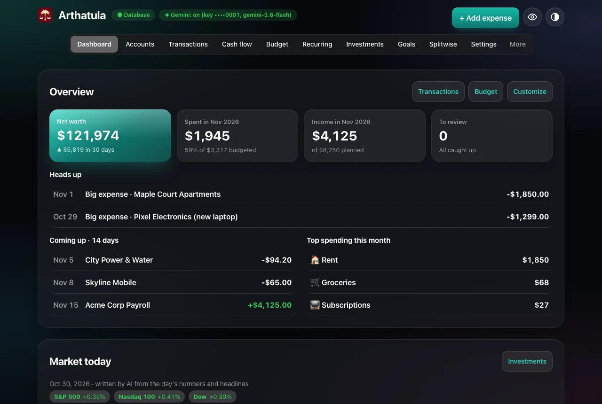

<p align="center">
  
</p>

<h1 align="center">Arthatula</h1>

<p align="center">
  <b>Your money, on your own server.</b><br>
  A private budget, net-worth and investments app with an AI helper, that you deploy to
  your own free Cloudflare account in about five minutes.
</p>

<p align="center">
  <a href="https://deploy.workers.cloudflare.com/?url=https://github.com/nisarg0606/arthatula"></a>
</p>

<p align="center">
  <a href="https://github.com/nisarg0606/arthatula/actions/workflows/deploy.yml"></a>
  
  
  
  
  <a href="LICENSE"></a>
  <a href="https://liberapay.com/nisarg001/donate"></a>
</p>

<p align="center">
  <a href="docs/GUIDE.md"><b>Guide</b></a> ·
  <a href="#get-your-own-copy-about-5-minutes-free"><b>Get your copy</b></a> ·
  <a href="#features"><b>Features</b></a> ·
  <a href="#security-v7"><b>Security</b></a>
</p>

<p align="center">
  
</p>

<p align="center"><sub>All screenshots use made-up sample data.</sub></p>

## Why Arthatula

- **Private by design.** Your data lives in a database in *your* Cloudflare
  account, behind your own access code. No company in the middle, no ads,
  no selling your data.
- **Free to run.** It fits in Cloudflare's free plan. No subscription.
- **Everything in one place.** Budgets, every transaction, net worth,
  investments, recurring bills, goals, cash flow and Splitwise balances.
- **An AI that helps instead of nagging.** It sorts your spending, checks
  new bank payments against your history, answers "can I afford it?",
  and writes a short market recap every evening. Use Gemini (free tier),
  Grok or any OpenAI-compatible model, or none at all.
- **Your AI agent can drive it.** It's an MCP server, so Claude, Cursor
  and other agents can read your budget and log expenses for you.
- **Feels like an app on your phone.** Add it to your Home Screen and it
  runs full screen, in light or dark mode.
- **Small and readable.** Vanilla HTML, CSS and JavaScript, no framework
  and no build step, with unit and browser tests on every change.

## Features

<table>
  <tr>
    <td width="50%"></td>
    <td width="50%"></td>
  </tr>
  <tr>
    <td><b>Investments.</b> Your brokerage and retirement accounts' value over time, today / week / month / year change, and an S&amp;P 500 line to see if you're beating the market. A <b>Market today</b> recap lands every evening.</td>
    <td><b>Budget.</b> Plan any month per category, roll leftovers over, and tap the <b>avg</b> chip to plan what you really spent over the last three months.</td>
  </tr>
  <tr>
    <td></td>
    <td></td>
  </tr>
  <tr>
    <td><b>Cash flow.</b> Income vs spending month by month, your savings rate, where the money went, and a 12-month forecast.</td>
    <td><b>Transactions.</b> One feed for every account: search, filter, split, tag, set your share, and clear the review queue the AI pre-checks for you.</td>
  </tr>
  <tr>
    <td colspan="2"></td>
  </tr>
  <tr>
    <td colspan="2"><b>Holdings.</b> Every stock, fund and cash position from your brokerage and retirement accounts (through the bank sync): shares, latest price, value, and gain or loss against what you paid, plus the total.</td>
  </tr>
</table>

<table>
  <tr>
    <td width="30%"></td>
    <td width="30%"></td>
    <td>
      <b>Made for your phone.</b> A thumb-friendly tab bar with a big <b>＋</b> to log
      spending in seconds.<br><br>
      <b>Show it off without showing your numbers.</b> Tap the eye and every
      amount becomes <code>$•••</code>, while merchants, categories and chart
      shapes stay.<br><br>
      <b>Make Home yours.</b> <b>Customize</b> picks which cards show and their
      order, and it follows you to every device.<br><br>
      <b>Heads up.</b> Categories over budget and unusually big expenses are
      flagged before they surprise you.
    </td>
  </tr>
</table>

<p align="center">
  
</p>

**Also inside:** recurring bills and subscriptions (found for you in your
transactions), savings goals, Splitwise balances, rules that file
merchants automatically, category emoji, credit-card statement cycles,
optional bank sync through Plaid, JSON/CSV export, and a classic
13-month planner with planned vs actual.

**New here? Read the [guide](docs/GUIDE.md)** — setup, using it on your
phone, AI (Gemini, Grok, others), the market recap, and connecting your
AI agent (MCP).

## Get your own copy (about 5 minutes, free)

[](https://deploy.workers.cloudflare.com/?url=https://github.com/nisarg0606/arthatula)

1. Click the button and sign in to Cloudflare (or create a free
   account). Connect GitHub when it asks: it copies this project into
   your account so you get updates on your own terms.
2. When it asks for **SETUP_SECRET**, type any long phrase you make up
   and keep it for step 3. Leave everything else as it is and deploy.
   Cloudflare creates your app and its database.
3. Open the address it gives you (`https://arthatula.<you>.workers.dev`),
   enter the setup secret, and choose your **access code**: the password
   you'll use on each of your devices.
4. On iPhone: Share → **Add to Home Screen**, so it opens full screen
   like an app.

Your data lives only in your own Cloudflare account; nobody else's copy
can see it. To turn on the AI features, open Settings in the app and
paste a Gemini key (free at <https://aistudio.google.com/apikey>).

## The classic 13-month planner

For each month you enter take-home pay, other income, and your expenses
(rent, utilities, phone/internet, groceries, eating out, gas/transport,
insurance, subscriptions, shopping/personal, loan EMI, credit-card and other
loan payments, one-off expenses with a note, and other expenses, plus a
free-text month note). The app instantly shows:

- Total income, total expenses, and **net saved over the 13 months**
- **Ending balance** (starting balance + net saved), average net per month,
  and savings rate
- A month-by-month table (income, expenses, net, cumulative balance)
- A cumulative-balance chart (inline SVG)

Shortcuts: **Copy month to all** and **Copy previous month** (both copy
recurring income/expenses only — one-off amounts and one-off notes are never
copied), **Reset to blank**, and **Export / Import JSON** for backup or
moving your numbers between devices.

## Planned vs actual — anchored to a baseline date

The prediction is anchored to **actuals from a baseline date**: the
starting balance is the *actual* balance on that date (a field in the
app and in the database settings, defaulting to the day you set the app
up, with a free-text baseline note next to it). The plan covers 13
months from the month you set it up (`plan_start` in the database
settings) and keeps going through the current month once time runs past
them. The months start out as a **plan**. As each month actually happens, fill in its
**Actual** view (Month editor → Planned/Actual toggle) with the real
income and expenses. The summary and table then compare, per month:

- predicted net vs actual net, and the **variance (actual − predicted)**
- predicted cumulative balance vs actual cumulative balance (the actual
  line is only carried forward while actuals are entered contiguously
  from the first month — a month with no actuals shows blank, never a
  fake zero)

Export/Import JSON carries the plan, the actuals, the daily expenses and
the baseline together.

## Daily expenses + Gemini auto-categorization

The **Daily expenses** tab is the day-to-day workflow (counted from the
baseline date onwards): quick-add a date (defaults to today), description
and amount, and the category fills in automatically — you can always
override it before or after saving. Entries are grouped by day and
month with per-day and per-month totals, and can be edited or deleted.

**Rollup rule (chosen approach):** daily expenses are *synced* into
`monthly_actuals`. For any month that has daily entries, the daily log
is authoritative for that month's actual **expense** fields — each
actual expense field becomes the summed daily total for its category
(Gym and Misc/Other both roll into Other Expenses; Loan/Debt Payment
rolls into Other Loan Payment). Because the rollup *replaces* rather
than adds, a daily expense is never double-counted next to a manually
typed actual, and the planned-vs-actual variance always uses the rolled
totals. Actual income is still typed by hand (the daily log is expenses
only), and months with no daily entries keep their manual actuals.

**How categorization works**

1. If a Gemini API key is configured, `POST /api/categorize` asks Gemini
   to pick exactly one category from the fixed list (JSON-only reply,
   validated against the list) and returns `source: "gemini"`.
2. Otherwise — or if the call fails or answers outside the list — it
   falls back to keyword rules (`source: "rules"`: supermarket/grocery
   names → Groceries, fuel brands → Fuel/Transport, streaming services
   → Subscriptions, and so on).
3. A category you pick yourself is stored as `source: "manual"`.

**Getting a Gemini API key (free)**

1. Go to Google AI Studio (<https://aistudio.google.com/apikey>) and
   create an API key. The default model, `gemini-3.6-flash`, is a
   Flash-Lite text model available on the free tier; the model name can
   be changed in Settings or via the `GEMINI_MODEL` environment variable.
2. Configure it one of two ways:
   - **In the app (preferred for personal deploys):** Settings tab →
     paste the key → Save. It is stored server-side in the D1 settings
     table and used only by the categorize Function. The settings API
     never returns the key — only `hasKey` and its last 4 characters —
     and you can clear it from the same screen.
   - **As a Cloudflare secret:** Pages project → Settings → Environment
     variables → add `GEMINI_API_KEY` (encrypt it). An env key takes
     precedence over a saved one and can't be cleared from the UI.
3. **Security notes:** never commit a key to git or put one in this
   repo; treat a pasted key like a password; in Google Cloud, restrict
   the key to the Generative Language API (and your project) so a leak
   can't be used for anything else; rotate it if you ever suspect it
   leaked. Free-tier usage is rate-limited, which is plenty for a
   handful of expenses a day.

## How your data is stored

This app has two storage modes, shown by the badge in the header:

- **Database mode (Cloudflare Pages + D1):** the frontend talks to a Pages
  Function at `/api/budget` (`functions/api/budget.js`), which stores
  everything in a Cloudflare D1 database bound as `DB` — the same pattern
  as a shared live tracker. Your data follows you across devices, and edits
  save automatically.
- **Local only mode (fallback):** if the API is unreachable — local
  development with a plain static server, or a static deploy on Netlify or
  Vercel (D1 is a Cloudflare feature) — the app stores everything in the
  browser's `localStorage` instead. The badge reads "Local only" so you
  always know where your numbers are going. A local mirror is also kept as
  a safety net while in database mode.

Either way, the code in this repository contains **no personal financial
numbers**: a fresh install starts completely blank. Your real numbers only
ever live in the database (or your browser), and any exported
`budget-data.json` file is git-ignored — never commit it.

Layout:

```
index.html            the page (Tailwind + Chart.js via CDN, tabbed dashboard UI)
styles.css            small custom extras on top of Tailwind (badges, dynamic form/table, dark overrides)
js/main.js            entry point: wires up every screen module in order, then starts
js/core/*.js          pure calculations (plan, spending, summary, review rules, dates, cards, formatting), unit-tested
js/ui/*.js            one module per screen or feature; shared runtime state lives in js/ui/context.js
functions/api/budget.js   Pages Function: GET / PATCH / POST / PUT /api/budget (+ daily-rollup sync)
functions/api/actuals.js  Pages Function: PUT /api/actuals (one month's actuals)
functions/api/expenses.js Pages Function: daily expense CRUD at /api/expenses
functions/api/categorize.js Pages Function: POST /api/categorize (Gemini + rules fallback)
functions/api/settings.js Pages Function: GET / PUT /api/settings (masked Gemini status, key saving)
functions/api/sync-requests.js + sync-requests/  Pages Functions: the "Sync now" request queue (file / latest / claim / complete)
tools/sync-poller.mjs   VM poller: claims queued sync requests and runs the Plaid sync engine (no agent)
functions/api/auth.js     Pages Function: /api/auth (setup, sign-in, sessions, pairing)
functions/api/mcp.js      Pages Function: /api/mcp — MCP server for AI assistants (see "AI assistant (MCP)")
functions/_middleware.js  security headers (CSP, framing, no-store on the API) for every response
theme-init.js         head script (kept out of index.html for the CSP)
tailwind.config.js, tailwind.css  Tailwind config and the prebuilt CSS the page loads (CI checks it is current)
vendor/                   vendored Chart.js 4.4.1 (MIT, see vendor/chart.js-LICENSE.md)
functions/api/_categories.js  fixed category list, category->field map, keyword rules
schema.sql            D1 tables: budget_settings, monthly_budgets, monthly_actuals, daily_expenses (money as integer cents in the budget tables)
wrangler.toml         Cloudflare Pages config incl. the D1 binding (placeholder id)
netlify.toml          Netlify static deploy (local-only mode)
vercel.json           Vercel static deploy (local-only mode)
tests/api.test.mjs    local test: runs the API handlers against in-memory SQLite
```

## Security (v7)

The deployed app holds real financial data behind a public URL, so:

- **Setup secret.** Creating the access code requires the
  `SETUP_SECRET` environment secret. Before the first sign-in, add it:
  Pages project → Settings → Variables and Secrets → Add → type
  *Secret*, name `SETUP_SECRET`, a long random value → Save, then
  redeploy. The setup screen asks for it. Once your code exists you can
  delete the secret — setup then stays locked for good. Without the
  secret nobody (including you) can claim a fresh database.
- **Access code.** At least 12 characters, stored as salted
  PBKDF2-SHA256 (100k iterations). Codes stored by v6.x as plain SHA-256
  still work and are upgraded on the next sign-in.
- **Attempt limit.** Every secret check (sign-in, change-code, setup
  secret, pairing code) is counted *before* it's checked: 5 per IP and
  20 overall per 10 minutes, then HTTP 429. Parallel bursts get no
  extra guesses. Devices that are already signed in are unaffected.
- **Old deployments.** Cloudflare keeps every deployment reachable at
  its own `https://<hash>.<project>.pages.dev` URL, running *that*
  version's code against the same database. v1–v5 had no sign-in at
  all, so delete every deployment older than the current one: Pages
  project → Deployments → ⋯ → Delete deployment. Repeat after any
  release that changes authentication. (Putting the project behind
  Cloudflare Access covers every deployment URL at once.)
- **Headers.** `functions/_middleware.js` adds a Content-Security-Policy
  (scripts only from this origin + the pinned Tailwind CDN; network
  requests only to this origin), `frame-ancestors 'none'`, and
  `no-store` on `/api/*`. If you deploy a hand-bundled Advanced Mode
  `_worker.js`, build it with `npx wrangler pages functions build
  --outdir=<dir>` so the middleware is included.
- **Third-party code.** Chart.js is vendored in `vendor/` (from npm
  `chart.js@4.4.1`). Tailwind is built ahead of time into
  `tailwind.css`, so no third-party script runs on the page
  (`script-src 'self'`). After changing Tailwind classes in
  `index.html` or `js/`, rebuild it:
  `npx -y tailwindcss@3.4.17 -c tailwind.config.js -o tailwind.css --minify`.

### Pairing the Plaid sync script

1. Settings → Security → **Pair automation**. A one-time code like
   `K7QD-9MXR` appears; it works once and expires in 10 minutes.
2. The script generates its own token locally (32 random bytes,
   base64url), keeps it, and sends only the hash:
   `POST /api/auth {"action":"pair-request","pairCode":"K7QD-9MXR","tokenHash":"<sha256 hex of token>","label":"Plaid sync"}`
   The reply carries `fingerprint` (the first 8 hex characters of the
   hash); the script prints it.
3. Settings shows the request with its fingerprint. Approve only if it
   matches what the script printed.

A sync session lasts 180 days (re-pair to renew) and is least-privilege:
it may `GET`/`POST /api/expenses`, `GET`/`PUT /api/cards` (statement
roll-forward), `POST /api/bank`, `POST /api/pending`, claim and complete
manual sync requests (`GET /api/sync-requests/claim`,
`POST /api/sync-requests/:id/complete`), and sign itself out. Everything
else — the budget, settings, sessions, pairing, filing sync requests,
deleting or editing expenses — answers 403.

### AI assistant (MCP)

The app is also an MCP server (Model Context Protocol, stateless
Streamable HTTP) at `/api/mcp`, so an AI assistant — Claude, ChatGPT,
Cursor, Grok (xAI remote MCP), or any other MCP client — can work with
the budget through tools instead of the raw API:

- **Read (classic, dollars):** `get_budget`, `list_expenses`,
  `list_cards`, `get_bank_snapshot`, `list_pending_charges`,
  `get_sync_status`, `categorize_expense`
- **Read (money model, signed cents):** `list_accounts` (balances + net
  worth), `list_transactions` (date range, account, category, text,
  to-review filters), `get_budget_status` (budget vs. actual for a month)
- **Write:** `add_expense`, `update_expense`, `delete_expense`,
  `request_sync` — expense writes run the same cores as `/api/expenses`,
  so auto-categorization, dedupe, bank auto-link and the monthly rollup
  behave exactly as in the app (and the new screens see them too).

Connect one in Settings → Security → **AI assistant (MCP)** → *Create
MCP token*. The token is shown once, together with the endpoint
(`https://<your-app>/api/mcp`) and a ready-to-paste config. For Claude
Code (`.mcp.json`) or Cursor (`.cursor/mcp.json`), merge it into the MCP
settings file:

```json
{ "mcpServers": { "arthatula": {
  "type": "http",
  "url": "https://<your-app>/api/mcp",
  "headers": { "Authorization": "Bearer <token>" }
} } }
```

(Claude Code can also add it in one line:
`claude mcp add --transport http arthatula https://<your-app>/api/mcp --header "Authorization: Bearer <token>"`.)
Claude Desktop's config file only starts local servers, so bridge to the
remote one with [`mcp-remote`](https://www.npmjs.com/package/mcp-remote)
(needs Node.js) in `claude_desktop_config.json`:

```json
{ "mcpServers": { "arthatula": {
  "command": "npx",
  "args": ["-y", "mcp-remote", "https://<your-app>/api/mcp", "--header", "Authorization:${ARTHATULA_AUTH}"],
  "env": { "ARTHATULA_AUTH": "Bearer <token>" }
} } }
```
Any other MCP client: choose the **Streamable HTTP** transport, point it
at `https://<your-app>/api/mcp`, and send the header
`Authorization: Bearer <token>`. The server is stateless, so `GET` (SSE)
and `DELETE` answer 405; everything is a JSON-RPC `POST`.

The token is an `mcp` session — a third least-privilege kind next to
device and sync sessions. `requireAuth` refuses it on every route
except `/api/mcp`, so it can never open the app, call the raw API
(including `/api/v2/*`), change settings or the access code, or manage
devices. Only a signed-in device can create one. It appears in the
sessions list (badge **MCP**): revoke it there any time, and changing
the access code signs it out like every other session. Its 90-day
window slides as it is used, like a device session. Sync tokens are
refused on `/api/mcp`.

### What the app expects from the sync (contract)

All calls carry `Authorization: Bearer <sync token>`. Amounts are dollars.

- `POST /api/expenses { date, description, amount, category?, card?, myShare?, bankTxId? }`
  - **201** `{ expense, state }`: created.
  - **200** `{ expense, duplicate: true, state }`: **not** created, because the
    bank transaction (`bankTxId`, or an exact match on date + name +
    amount) is already linked to an expense. Treat it as success; it is
    how re-imports and hand-entered expenses stay counted once.
  - Send `bankTxId` (the Plaid `transaction_id`) for bank outflows when you
    can; exact matches link automatically either way.
- `POST /api/bank { accounts: [...], transactions: [...], syncedAt }`:
  upserts the Bank tab snapshot by Plaid id (max 500 of each per call).
  Transactions keep Plaid's sign: **positive = money out**, negative = in.
  Send `pfc` (Plaid's primary category, e.g. `TRANSFER_IN`,
  `LOAN_PAYMENTS`, `INCOME`): the Daily review list uses it to tell
  person-to-person money from card bills and paychecks.
- `POST /api/pending { transactions: [{ id, date, name, amount, accountLabel, category }], syncedAt }`:
  replaces the pending snapshot. `id` must be Plaid's `transaction_id` of
  the **pending** charge; `accountLabel` should be the app's card name
  (e.g. `Amex`) and `category` an app category.
- **Pending charges counted early ("Count it now").** When a charge posts,
  send these on its `POST /api/expenses` import:
  - `pendingTransactionId`: Plaid's `pending_transaction_id` of the posted
    transaction. If the owner already counted that pending charge, the
    app **updates that expense** (to the posted amount) instead of adding
    a new one, and replies **200** `{ expense, duplicate: true, settled: true }`.
    Treat it as success.
  - `bankTxId`: Plaid's `transaction_id` of the posted charge, for card
    charges too, so a re-sent import is recognised.
  - `card`: the app's card name, the same value as the pending charge's
    `accountLabel`.
  Without `pendingTransactionId`, the app falls back to settling a counted
  charge with the same card and the same merchant name within 5 days.
  Anything it can't match shows up in the Daily tab for the owner.
- `GET /api/expenses`, `GET`/`PUT /api/cards`: as before.
- Manual sync requests (the Daily tab's **Sync now** button): the app
  queues a request in D1; a poller running next to the sync engine
  (`tools/sync-poller.mjs`, with `tools/budget-sync-poller.service` as
  its systemd user unit) polls `GET /api/sync-requests/claim` every
  30 s, runs the engine when it claims one, and reports back with
  `POST /api/sync-requests/:id/complete` `{ status: "done" | "failed",
  result: <run summary> }`. Device sessions file requests
  (`POST /api/sync-requests`) and read the newest one
  (`GET /api/sync-requests/latest`); an active request younger than
  10 minutes is returned instead of duplicated, and one older than
  that is expired to `failed` so the button can never wedge.
- Don't import as expenses: transfers between the owner's own accounts,
  card bill payments, refunds or money in. The app pairs own-account
  transfers itself and asks the owner about money to or from people.

## The new money model (v2): accounts, transactions, budgets, net worth

The app now has a second, Monarch-style model beside the classic
12-month planner. New tabs: **Accounts** (net worth and every account),
**Transactions** (one feed: search, filters, review queue, splits, tags,
my share), **Cash flow** (income vs spending by month, spending by
category, a rolling 12-month forecast), **Budget** (any month, per
category, rollover), **Recurring** (bills and income, suggestions found
in your transactions, card due dates), **Investments** and **Goals**. The
Dashboard opens with an Overview, and Settings gains categories, rules,
market data, export and a migration check. The classic tabs (Month
editor, Daily, Cards, Bank) keep working unchanged; on wide screens they
sit under **More** at the end of the tab bar.

**Dashboard extras.** The Overview's **Heads up** list flags categories
over budget and big expenses from the last 7 days (at least 3× your
typical expense over 90 days, and never under $100). **Customize** shows,
hides and reorders the Dashboard's cards; the layout is saved per owner
(`GET/PUT /api/v2/layout`, `functions/api/v2/layout.js`). The **eye**
button in the header hides every amount: the three money formatters
(`js/core/format.js`, `js/ui/charts.js`, `js/ui/v2/kit.js`) print `$•••`
while `<html>` has the `hide-amounts` class, chart axes and tooltips are
masked, and typed amounts and Ask answers are blurred. It's remembered per
device and applied before first paint (`theme-init.js`).

**Budget suggestions and category emoji.** Each budget row carries the
category's average actual over the previous 3 months (`avgCents`), shown
as a chip that plans that amount when tapped; categories spent on in
those months appear even before this month has activity. Categories have
an optional emoji (`icon`), shown wherever the name is.

**Investments.** `GET /api/v2/investments` builds the total value of the
investment accounts per day from the balance snapshots the sync records
(`investmentSeries` / `changeOver` in `js/core/v2/money.js`), with
day / week / 30-day / 1-year change per account and in total, and SPY
closes from the saved market recaps for an S&P 500 comparison line. It
also returns **holdings** (table `holdings`): the positions the sync
pushes in `POST /api/v2/sync` as an optional `holdings` list
(`{ accountId, securityId, ticker?, name?, quantity, costBasisCents?,
priceCents?, valueCents?, kind?, asOf? }`, Plaid's investment holdings).
When the key is present it is the complete set for the pushed accounts,
so sold positions disappear; an older sync that leaves it out doesn't
touch stored holdings. The Holdings card shows shares, price, value and
gain against cost basis; with the eye on, share counts are hidden too.

**Market today.** After each US close, `functions/api/_market.js` fetches
quotes for SPY, QQQ and DIA (Finnhub's free plan quotes funds, not the
indexes) and the day's general headlines, and the AI provider writes a
3–4 sentence recap from only those (a plain one-liner without an AI key).
One recap per trading day is kept in `v2_settings` as
`market:YYYY-MM-DD`. Pages has no cron, so `GET /api/v2/market` writes it
on the first visit after 4:10 pm New York; Worker deployments also run it
from a nightly cron (`wrangler.toml [triggers]`, `scheduled` in
`worker.js`). The trading day comes from the quote's own timestamp, so
holidays need no calendar; a failure is retried after 15 minutes, not on
every visit. Key: **Settings → Market data**, or the `FINNHUB_API_KEY`
secret (it wins over the saved one).

**Auto-review and Mark all reviewed.** Each time the app opens,
`POST /api/v2/autoreview` (`functions/api/_v2autoreview.js`) checks
the bank rows that are waiting on To review before you do. A row is
compared with similar past rows you reviewed yourself (same direction,
similar name) and with daily-log entries of the same amount within 3
days. These go to Gemini in one batched call, and each row gets one of
three outcomes:
- **seen**: you've had this kind of payment before. It gets the
  category the past rows used, so it is counted, and it shows a
  **✓ Checked by Gemini** chip with Gemini's reason.
- **duplicate**: it's already in your daily log. It is taken off the
  list and not counted twice.
- **ask**: anything new or unclear stays for you.

Gemini can only pick a category that its similar past rows used. With
no key, or when Gemini fails, a strict rule stands in: the same name on
at least 2 past rows that share one category, or exactly one
same-amount daily-log entry. Each row is looked at once. "Not right" in
a row's dialog puts it back on To review for good, and "Looks right"
confirms it. The Overview shows a **Checked by Gemini** tile, and
Transactions has a matching filter. With **To review only** ticked, a
**Mark all reviewed** button clears the whole list; each row keeps the
category it has. Auto-review doesn't change the classic Daily review
list.

**How your classic data gets there.** A mirror
(`functions/api/_v2mirror.js`) copies the classic tables into the new
ones whenever they change: daily expenses, bank rows that aren't
already an expense (income, repayments, card payments, transfers),
typed-in actuals, bank accounts, cards and the plan. The daily log stays
the record for its rows: editing one on the new screens writes the
change back to the classic log. **Settings → New model check** compares
classic actuals with the new model month by month; every plan month must
match to the cent (rows added on the new screens are listed apart).
Spending from before the baseline date counts on the new screens as
history (cash flow, categories, trends) but stays out of the classic
balance and actuals, which start from the baseline snapshot, and out of
this check.

**Just you.** This is a personal tracker with one owner. Every new
table still carries an `owner_id`, and every query goes through one
scoped helper (`functions/api/_v2db.js`) that refuses SQL not pinned to
it, so your data would stay separate if the app were ever opened to
someone else.

**Sync push for the automation (optional, adds net worth).** The paired
sync can also push every account with its balance — cards, loans and
investments included — to `POST /api/v2/sync` (sync token only):

```
{ "asOf": "2026-11-20",
  "accounts": [ { "id": "<plaid account_id>", "name": "…", "institution": "…",
                  "type": "depository|credit|loan|investment|other",
                  "subtype": "…", "mask": "1234",
                  "balanceCents": 432150, "availableCents": 430000 } ] }
```

Balances are integer cents; credit and loan balances are what is owed.
Each push records the day's balance, which is what the net-worth chart
is drawn from. Transactions keep arriving through the classic endpoints
as before. A classic card with the same name as a synced credit account
is treated as the same card.

**API.** All under `/api/v2/`, device sessions only (except `sync`):
`accounts`, `transactions`, `categories`, `rules`, `budgets`,
`reports?kind=summary|cashflow|forecast`, `recurring`, `goals`,
`networth`, `investments`, `market`, `layout`, `export?format=json|csv`,
`migration`. Money crosses this API
as signed integer cents (negative = money out). Each file's header
documents its routes.

## This deployment: arthatula + the shared database

The original deployment runs on Cloudflare **Pages** (copies made with
the Deploy button run as a **Worker** from the same code: `worker.js`
routes `/api/*` to the same handlers in `functions/`). It is bound to the
**same D1 database** as the original `monthly-budget` app, so both sites
show the same data and accept the same access code.

`.github/workflows/deploy.yml` deploys it when a pull request is merged
into `main` (or from Actions → "Test and deploy" → Run workflow). It
writes the Pages config at deploy time from these repository settings
(Settings → Secrets and variables → Actions):

- secret `CLOUDFLARE_API_TOKEN` (Cloudflare Pages: Edit and D1: Edit)
- variables `CLOUDFLARE_ACCOUNT_ID`, `D1_DATABASE_ID`, `PAGES_PROJECT`

A fork without them skips the deploy job.

The nightly encrypted database backup stays in the original repo (both
apps share one database, so one backup covers both).

## Deploy on Cloudflare Pages + D1 (recommended — database mode)

1. **Create the D1 database**
   - Cloudflare dashboard → Storage & Databases → D1 SQL Database →
     Create, name it `monthly-budget`; **or** run:
     `npx wrangler d1 create monthly-budget`
   - Note the **database ID** it gives you.
2. **Create the tables** — either apply `schema.sql`:
   `npx wrangler d1 execute monthly-budget --remote --file=./schema.sql`
   or paste `schema.sql` into the D1 console. (The API also creates the
   tables on first request if they're missing.)
3. **Point `wrangler.toml` at your database** — replace
   `REPLACE_WITH_YOUR_D1_DATABASE_ID` with the real database ID from step 1.
   The binding name must stay `DB`.
4. **Create the Pages project** — dashboard → Workers & Pages → Create →
   Pages → Connect to Git → pick this repository. Framework preset: *None*.
   Build command: *leave empty*. Build output directory: `.`
   (Or deploy with `npx wrangler pages deploy . --project-name arthatula`.)
5. **Bind the database** (only needed if you deploy via the dashboard
   without `wrangler.toml`): Pages project → Settings → Bindings → Add →
   D1 database → variable name `DB` → select `monthly-budget`.
   Then redeploy once so the binding takes effect.
6. **Load your numbers** — open the deployed app, check the badge says
   **Database**, and either type your figures in or use **Import JSON**
   with a previously exported `budget-data.json`. Imports save through the
   API in database mode.
7. **(Optional) Turn on Gemini** — either add the `GEMINI_API_KEY`
   secret in the same Settings → Environment variables screen, or paste
   the key later in the app's own Settings tab (see "Daily expenses +
   Gemini auto-categorization" above).

### Updating later (pull request → deploy)

The Pages project is a Direct Upload project; GitHub Actions
(`.github/workflows/deploy.yml`) does the deploying. Every pull request
and every push to `main` runs the unit tests and the browser tests, and
**only a commit that came through a merged pull request is deployed.** A
commit pushed straight to `main` is tested but not shipped; the run shows
a "Not deployed" warning. So every change, by a person or an AI agent,
goes: branch → pull request → tests pass → merge → deploy. To redeploy
`main` by hand, use **Run workflow** on the "Test and deploy" action.

Your data in D1 is untouched by deploys.

### Backups

The nightly encrypted backup of the shared database runs in the original
`monthly-budget` repository (`.github/workflows/backup.yml` there): it
exports the database, gzips it, encrypts it with AES-256 using that repo's
`BACKUP_PASSPHRASE` secret, and keeps the encrypted file as a workflow
artifact for 90 days. Both apps use the same database, so that one backup
covers this app too.

To restore, download an artifact from the backup run, then:

```
openssl enc -d -aes-256-cbc -pbkdf2 -iter 200000 -in budget-YYYY-MM-DD.sql.gz.enc -out backup.sql.gz
gunzip backup.sql.gz   # backup.sql recreates every table and row
```

D1 also keeps its own point-in-time history ("Time Travel") for recent days.

## Deploy on Netlify (static, local-only mode)

1. Netlify → Add new site → Import an existing project → pick this repo.
2. Build command: *leave empty*. Publish directory: `.` (already set in
   `netlify.toml`).
3. Deploy. The API/D1 parts don't run on Netlify, so the app automatically
   uses its localStorage fallback ("Local only" badge).

## Deploy on Vercel (static, local-only mode)

1. Vercel → Add New → Project → import this repo.
2. Framework preset: *Other*. Build command and output directory are
   already set in `vercel.json` (static, output `.`).
3. Deploy. As with Netlify, the app runs in local-only mode on Vercel.

## Run locally

- Just the frontend (local-only mode):
  `python3 -m http.server 8000` and open <http://localhost:8000>
- Full stack incl. D1: `npx wrangler pages dev .` (uses a local D1).
- README screenshots: `node tools/readme-screenshots.mjs` starts a throwaway
  local copy with made-up sample data and rewrites `docs/screenshots/`
  (needs `cd e2e && npm ci` and `cwebp`).

## Tests

```
node tests/api.test.mjs         # budget + actuals API against an in-memory SQLite/D1 shim
node tests/expenses.test.mjs    # daily-expense CRUD + rollup into monthly actuals
node tests/categorize.test.mjs  # Gemini handler with a fake fetch + settings key masking
node tests/logic.test.mjs       # planned-vs-actual variance + daily rollup overlay (frontend logic)
node tests/auth.test.mjs        # setup secret + race, attempt limits, PBKDF2, guards, sessions, sync scope
node tests/pairing.test.mjs     # owner-opened pairing, fingerprint approval, hijack regression
node tests/v2-core.test.mjs     # v2 money logic: reports, rollover, forecast, net worth, rules, recurring, goals
node tests/v2-model.test.mjs    # v2 schema, owner scoping, the mirror and its totals gate
node tests/v2-api.test.mjs      # every /api/v2 route: guards, write-back, splits, budgets, reports, export
node tests/v2-autoreview.test.mjs # auto-review: name matching, strict rule, Gemini checks (fake fetch), Not right, Mark all
node tests/sync.test.mjs        # "Sync now" request queue: auth scope, dedupe, claim/complete, expiry
node tests/mcp.test.mjs         # MCP server: mcp-session scope, JSON-RPC handshake, every tool, revoke
node tests/market.test.mjs      # market recap: trading days, holidays, AI vs plain recap, retries; investments maths and routes
node tests/layout.test.mjs      # Dashboard layout: validation, save/load, reset
node tests/holdings.test.mjs    # holdings from the sync: store, replace, keep when absent, clear
for f in js/*.js js/*/*.js; do node --check "$f"; done   # frontend syntax check
```

Browser tests (Playwright: the real app in WebKit at iPhone size and in
desktop Chromium, against a throwaway local database):

```
cd e2e && npm ci && npx playwright install webkit chromium && npx playwright test
```

## Support the project

Arthatula is free and stays free. If it saves you money or time, you can
[buy me a coffee on Liberapay](https://liberapay.com/nisarg001/donate) ☕,
star the repo, or tell a friend.

<a href="https://liberapay.com/nisarg001/donate"></a>

## License

[MIT](LICENSE): use it, change it, share it, including in your own
projects. Keep the copyright notice.
